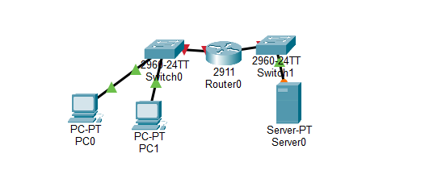
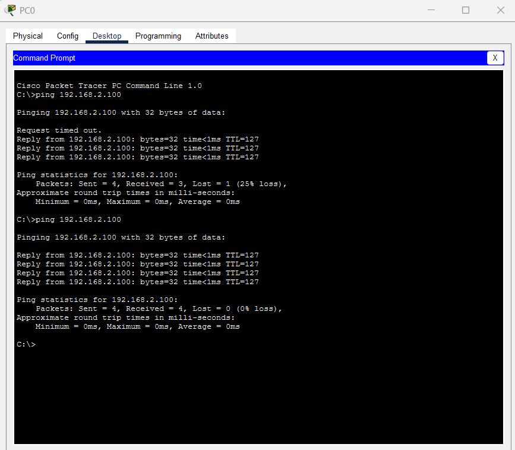
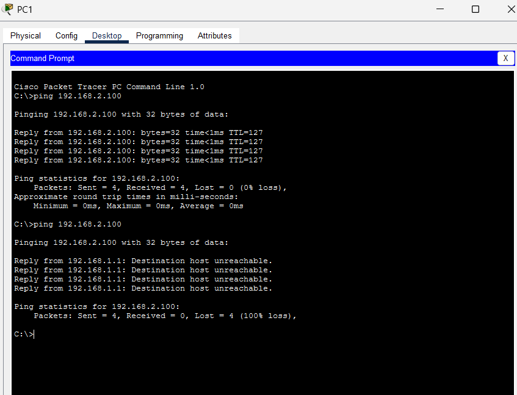
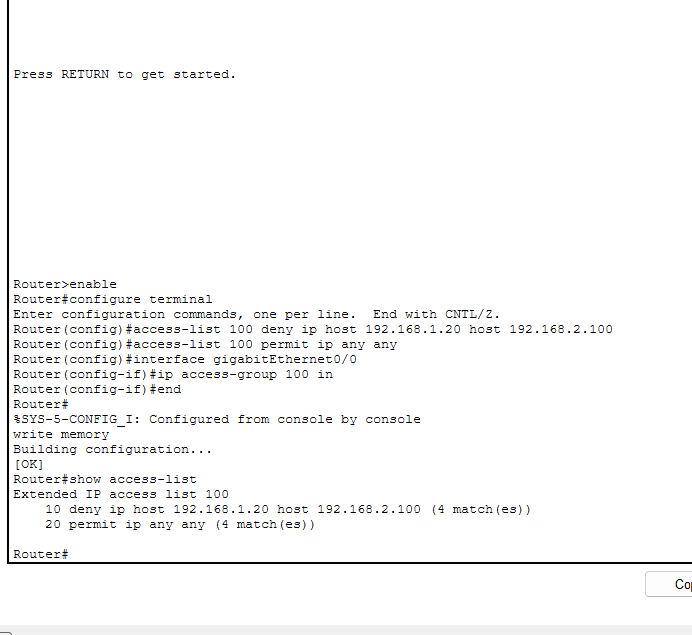

# Home Network Security Lab

## Overview
This Cisco Packet Tracer lab demonstrates host-based traffic filtering across two IPv4 /24 subnets. A trusted PC and guest PC share 192.168.1.0/24, while the server resides on 192.168.2.0/24. An extended router ACL denies IP traffic from the guest PC to the server and permits other IP traffic. Ping screenshots and ACL match counters document the tested behavior.

## Network Design
- Trusted PC: `192.168.1.10/24`
- Guest PC: `192.168.1.20/24`
- Router G0/0: `192.168.1.1/24`
- Router G0/1: `192.168.2.1/24`
- Server: `192.168.2.100/24`
- Default gateway for both PCs: `192.168.1.1`
- Default gateway for the server: `192.168.2.1`

## Security Rule
ACL 100 is applied inbound on GigabitEthernet0/0. Its first entry denies IP traffic from guest host 192.168.1.20 to server 192.168.2.100; its second entry permits all other IP traffic entering that interface. This rule filters a specific host-to-server path. The trusted and guest PCs remain on the same subnet.

```text
access-list 100 deny ip host 192.168.1.20 host 192.168.2.100
access-list 100 permit ip any any
interface gigabitEthernet0/0
ip access-group 100 in
```

## Testing
Verification used `ping 192.168.2.100` from both PCs and `show access-lists` on the router.

| Evidence | Recorded result |
|---|---|
| [Trusted PC ping](trusted_pc_ping_success.png) | The first run received 3/4 replies; the repeat received 4/4 replies with 0% loss. |
| [Guest PC ping](guest_pc_ping_blocked.png) | An earlier run received 4/4 replies. The subsequent blocked run received no server replies and displayed four "Destination host unreachable" messages from 192.168.1.1, with 100% loss. |
| [ACL 100 counters](acl_verification.png) | The guest-to-server deny entry recorded 4 matches; the permit entry also recorded 4 matches. |

Together, the ping results and deny matches support the demonstrated guest-to-server filtering. The configured rule covers IP traffic, but the screenshots demonstrate ICMP ping behavior; TCP and UDP application access were not separately tested in the supplied evidence.

To repeat the check:
1. Open `Home_Network_Security_Lab.pkt` in Cisco Packet Tracer.
2. Run `show access-lists` on the router and note the current counters.
3. Run `ping 192.168.2.100` from each PC. The trusted PC should receive server replies; the guest PC's ICMP ping to the server should be blocked, with no server replies. This check tests ICMP ping behavior only; it does not validate TCP or UDP application access.
4. Run `show access-lists` again and compare the counters. The guest-to-server deny counter should increase when guest traffic matches the rule. Totals may differ from the saved screenshot.

## Files
- `Home_Network_Security_Lab.pkt` - Cisco Packet Tracer project
- `router_config.txt` - Router interface and ACL configuration commands, verification commands, and endpoint addressing
- `network_topology.png` - full lab topology
- `trusted_pc_ping_success.png` - trusted PC ping results, including a repeat with 4/4 replies
- `guest_pc_ping_blocked.png` - guest PC ping results before and after filtering
- `acl_verification.png` - ACL configuration and match counters

## Skills Demonstrated
- Cisco Packet Tracer
- IPv4 addressing and subnetting
- Router interface configuration
- Routing between subnets
- Extended access control lists
- Traffic filtering
- Network troubleshooting and verification

## Project Description
Cisco Packet Tracer lab demonstrating IPv4 routing and extended ACL filtering, with trusted-versus-guest ping results and router match-counter evidence.

## Resume Bullet
- Built a two-subnet Cisco Packet Tracer lab and configured an extended ACL to block guest-to-server IP traffic; verified blocked guest pings and successful trusted pings using screenshots and ACL match counters.

## Screenshots

### Network Topology


### Trusted PC - Successful Ping


### Guest PC - Blocked Ping


### ACL Verification

